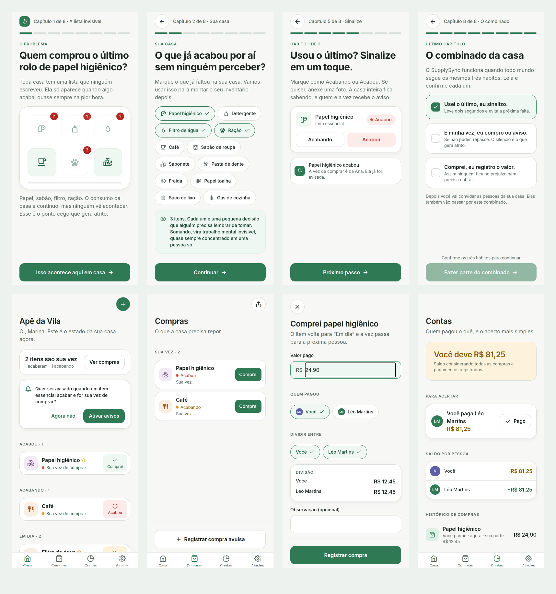

# SupplySync

Inventário compartilhado da casa, reposição inteligente e divisão de custos quase automática.
Para casais, famílias e grupos de 3 a 6 moradores que perdem tempo (e paciência) com
"quem comprou o último papel higiênico?".



## O que o MVP entrega

- **Onboarding narrativo em 8 capítulos**: mostra o problema, deixa a pessoa experimentar cada mecânica e termina com o "combinado da casa". Sem botão de pular; capítulos interativos só avançam após a interação. As respostas viram o inventário inicial.
- **Inventário compartilhado** com estados Em dia, Acabando e Acabou, sinalizados em um toque, com foto e observação opcionais.
- **De quem é a vez**: rodízio, preferência ou equilíbrio (quem gastou menos).
- **Avisos push** quando um item essencial acaba: quem está na vez recebe "é a sua vez"; o resto da casa sabe quem vai comprar.
- **Lista de compras automática**, separada entre "sua vez" e "outras pessoas", com estimativa de valor e compartilhamento em texto (WhatsApp, notas etc.).
- **Divisão de custos**: registrar compra, dividir entre quem participa, saldo por pessoa e sugestão do menor número de pagamentos.
- **Freemium** aplicado no servidor: 1 casa, até 6 moradores, 20 itens e 60 dias de histórico no plano gratuito.
- **Entrar com Google ou Apple**, além de e-mail e senha, e e-mail de boas-vindas ao criar a conta.
- **Segurança desde o início**: veja [docs/SECURITY.md](docs/SECURITY.md).

## Stack

App **Expo SDK 58 / React Native** (expo-router, TanStack Query, Reanimated) · API **Fastify 5 / Node 22** ·
**PostgreSQL + Prisma** · **Zod** compartilhado · monorepo npm workspaces.
Detalhes em [docs/ARCHITECTURE.md](docs/ARCHITECTURE.md).

## Rodando localmente

**Primeira vez? Siga o guia passo a passo: [docs/PRIMEIROS-PASSOS.md](docs/PRIMEIROS-PASSOS.md).**

Pré-requisitos: Node.js 22.12+ (LTS) e o app Expo Go no celular. Não precisa de Docker.

```bash
npm install
npm run dev        # na primeira vez também prepara tudo (o mesmo que npm run setup)
```

O `npm run dev` liga, nesta ordem: um PostgreSQL embutido (dados em `.data/postgres`), a API em modo de
desenvolvimento e o Expo, que mostra o QR Code. Ctrl + C desliga tudo.

- Os arquivos `.env` são criados pelo `npm run setup` com segredos aleatórios. Nunca vão para o Git.
- O app descobre sozinho o endereço do computador na rede (mesmo Wi-Fi). Para apontar para outra API,
  defina `EXPO_PUBLIC_API_URL` em `apps/mobile/.env`.
- Os e-mails não são enviados em desenvolvimento: o código de confirmação aparece em destaque no terminal.
- Avisos push não funcionam no Expo Go; para testá-los, gere um development build com `eas build --profile development`.
- Prefere Docker? `docker compose up -d` continua disponível; ajuste `DATABASE_URL` em `apps/api/.env`.

## Qualidade

```bash
npm run typecheck             # shared, api e mobile
npm test                      # testes de domínio e de integração da API
```

Os testes de integração usam um PostgreSQL real. Defina `TEST_DATABASE_URL` apontando para um banco descartável
(os testes apagam os dados dele).

## Publicação

Passo a passo para produção, Cloudflare (WAF), Google Play e App Store em [docs/DEPLOY.md](docs/DEPLOY.md).
Para ligar o envio de e-mails e o login com Google/Apple, de graça: [docs/EMAIL-E-LOGIN-SOCIAL.md](docs/EMAIL-E-LOGIN-SOCIAL.md).
